<div align="center">


<hr/>

### Ask a question. **Rewind to the source.**

Chat with your own documents. Every answer streams in with numbered citations,
and one click jumps you back to the exact passage it came from.

<br/>


</div>

---

## 🎬 The idea in one breath

> Most "chat with your PDF" tools sound confident even when they're guessing.
> **Rewind refuses to guess.** It answers *only* from passages it retrieved, shows you
> those passages as `[1]` `[2]` `[3]` chips, and says *"I couldn't find that in your documents"*
> when the answer isn't there.

| 🔍 Trustworthy | ⚡ Fast | 🔒 Private |
|---|---|---|
| Source-grounded answers with clickable citations | Token-by-token streaming over SSE | Every query is filtered by `user_id`, so users never see each other's chunks |

---

## ✨ Features

- 📄 **Upload PDF, DOCX, TXT, MD** with type and size limits (15 MB) and live status: `processing → ready / failed`
- 🧠 **Hybrid retrieval**: pgvector semantic search + Postgres full-text search, merged with Reciprocal Rank Fusion
- 💬 **Streaming chat** with inline citations, conversation history, and optional per-document scoping
- 🔁 **Click a citation to "rewind"** to the page and passage behind it
- 🔐 **Auth**: email + password (bcrypt, JWT) and **Sign in with Google**
- 🛡️ **Abuse protection**: Cloudflare Turnstile on sign-up, sliding-window rate limiter, daily signup cap, zip-bomb and page-count guards
- 📊 **Plans and usage tracking**: questions per day, document caps, per-user token accounting
- 🔀 **Provider failover**: Anthropic → Gemini → Groq, with retry and model fallback
- 🧪 **Eval harness** that reports retrieval hit rate and answer hit rate

---

## 🏗️ System architecture

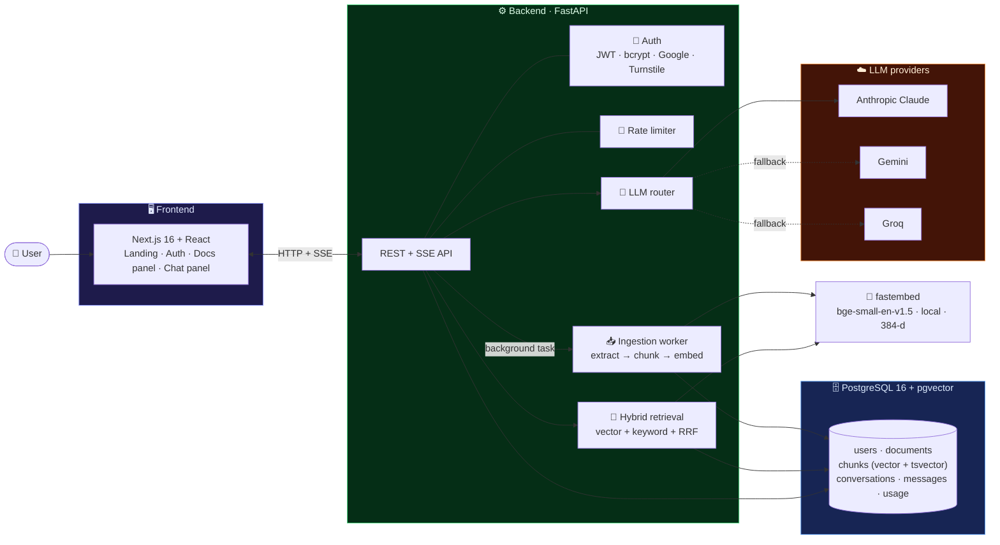

---

## 🔄 What happens when you ask a question

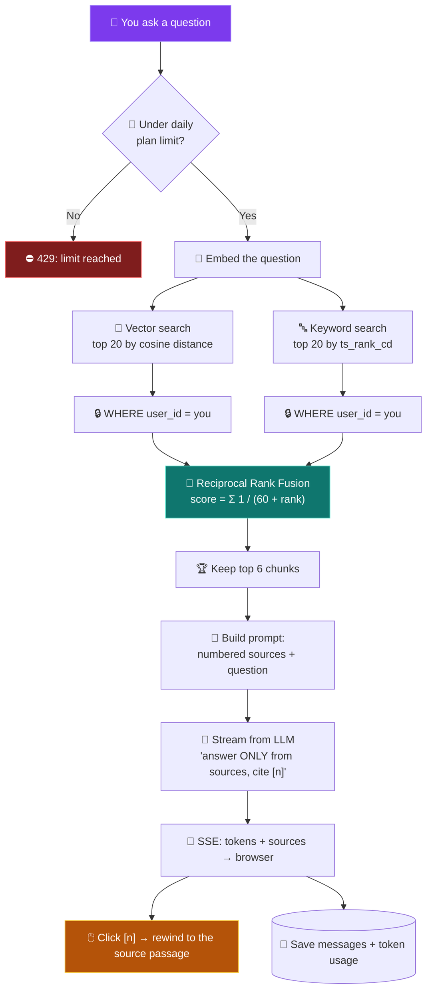

### The same flow as a conversation

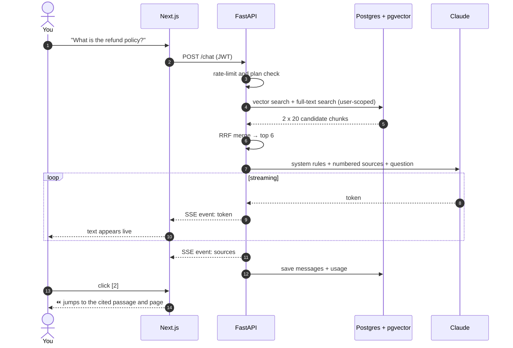

---

## 📥 What happens when you upload

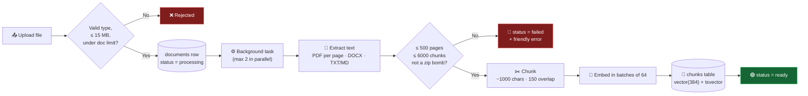

---

## 🗃️ Data model

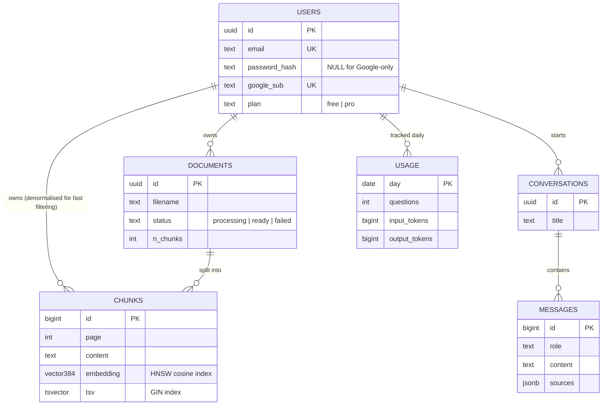

---

## 📈 By the numbers

### Plan limits

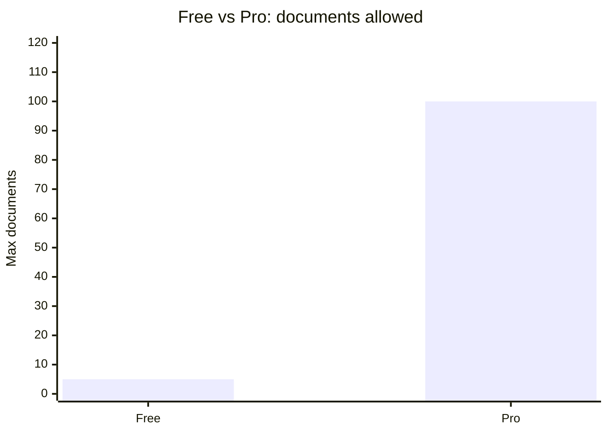

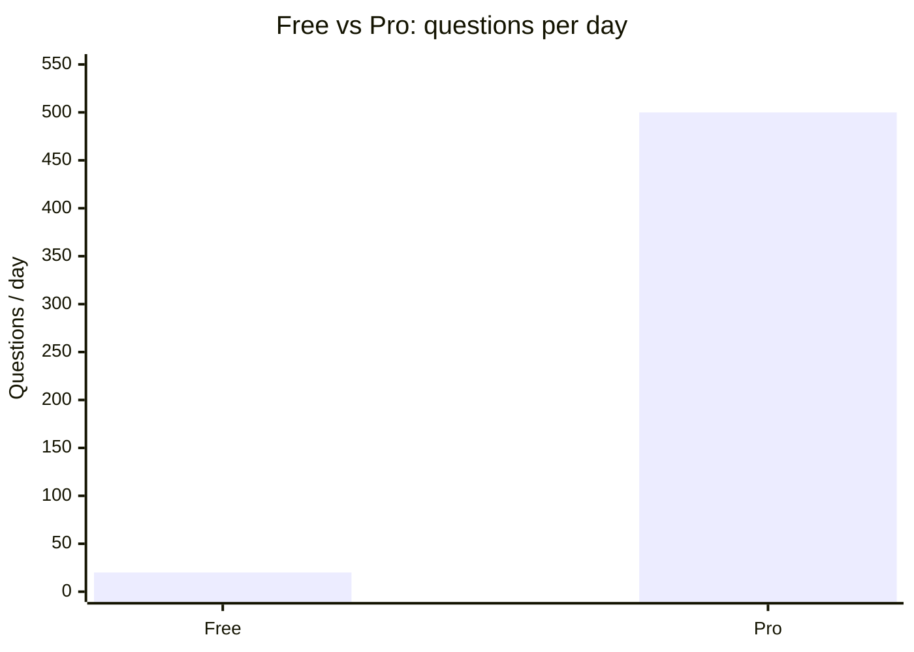

### Where the backend code lives (lines of Python)

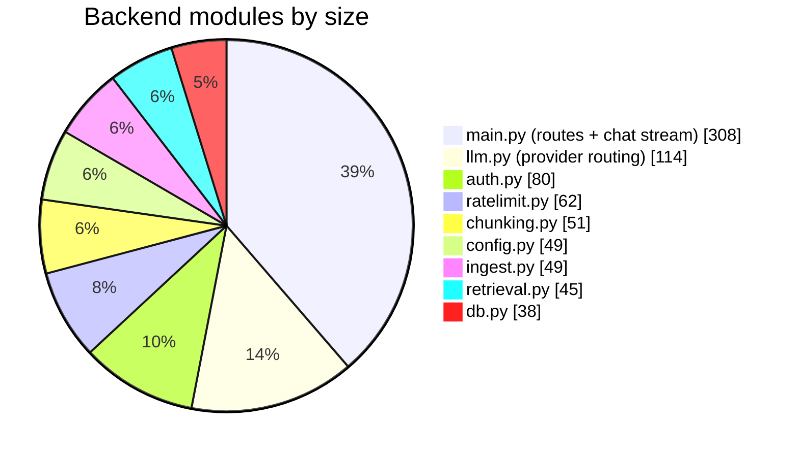

> The whole backend is under 800 lines, small enough to read in one sitting.

---

## 🧩 Why hybrid search?

Neither method wins alone, so Rewind uses both and lets them vote.

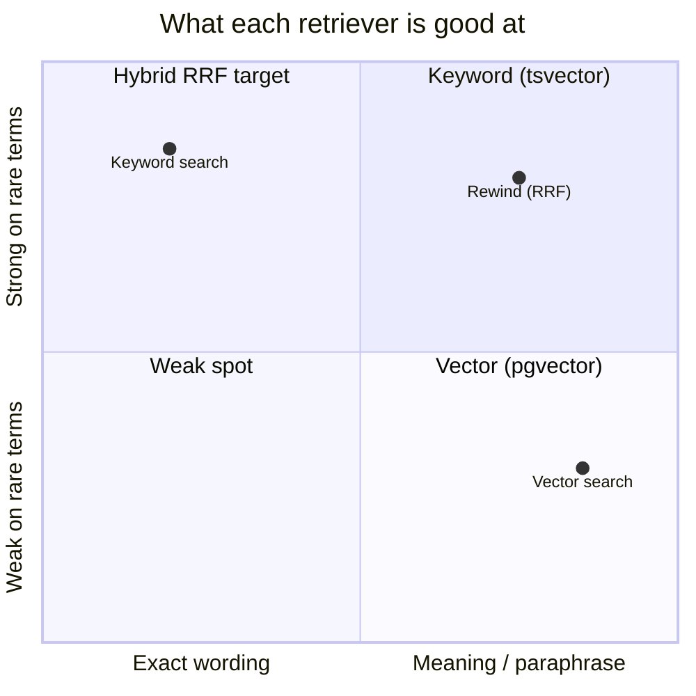

*(Illustrative positioning, not a measured benchmark. Use the eval script below to measure your own data.)*

---

## 🚀 Quick start

**1. Configure**
```bash
cp .env.example .env
# add ANTHROPIC_API_KEY and a long random JWT_SECRET
```

**2. Start the backend and database**
```bash
docker compose up --build
```
Postgres + pgvector and the API come up on **:8000**. The first start downloads the embedding model.

**3. Start the frontend**
```bash
cd frontend
cp .env.local.example .env.local
npm install
npm run dev
```

Open **http://localhost:3000** · API docs at **http://localhost:8000/docs**

> 💡 **No API key?** Rewind still works: it falls back to showing the most relevant passages from your documents.

---

## ⚙️ Configuration

| Variable | Purpose | Default |
|---|---|---|
| `ANTHROPIC_API_KEY` | Primary LLM provider | none |
| `ANTHROPIC_MODEL` | Claude model to use | `claude-sonnet-5-5` |
| `GEMINI_API_KEY` / `GROQ_API_KEY` | Free fallback providers | none |
| `JWT_SECRET` | Signs login tokens (**required in production**) | dev-only value |
| `GOOGLE_CLIENT_ID` | Enables Google sign-in | none |
| `TURNSTILE_SECRET_KEY` | Cloudflare human check on sign-up | off |
| `EMBED_MODEL` | Local embedding model | `BAAI/bge-small-en-v1.5` |
| `MAX_SIGNUPS_PER_DAY` | Site-wide signup cap | `500` |
| `MAX_PARALLEL_INGEST` | Documents processed at once | `2` |
| `APP_ENV` | `production` hides `/docs`, trusts proxy IP, enforces real secret | `development` |
| `CORS_ORIGINS` | Allowed frontend origins | `http://localhost:3000` |

### Provider selection

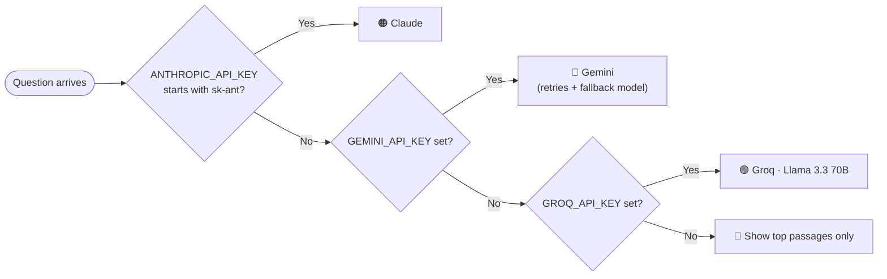

---

## 🔌 API at a glance

| Method | Endpoint | What it does |
|---|---|---|
| `POST` | `/auth/register` · `/auth/login` · `/auth/google` | Sign up and sign in |
| `GET` | `/me` | Current user, plan, and usage |
| `POST` | `/documents` | Upload a file (ingests in the background) |
| `GET` | `/documents` | List documents and their status |
| `DELETE` | `/documents/{id}` | Delete a document and its chunks |
| `POST` | `/search` | Raw hybrid search (60 req/min per user) |
| `POST` | `/chat` | Ask a question; streams `token` and `sources` events |
| `GET` | `/conversations` | List past conversations |
| `GET` | `/conversations/{id}/messages` | Load a conversation |

---

## 🧪 Evaluate retrieval quality

Put your own questions in `backend/eval/questions.json`:

```json
[
  { "question": "What is the notice period?", "expect": ["30 days"] }
]
```

```bash
python backend/eval/run_eval.py --email you@example.com --password •••••• \
  --questions backend/eval/questions.json
```

It reports **retrieval hit rate** (did the right chunk come back?) and **answer hit rate** (did the answer contain it?).

---

## 🗂️ Project structure

```
Rewind/
├── backend/
│   ├── app/
│   │   ├── main.py        # routes, SSE chat stream
│   │   ├── retrieval.py   # vector + keyword + RRF
│   │   ├── ingest.py      # background extract → chunk → embed
│   │   ├── chunking.py    # PDF/DOCX/TXT extraction, overlap chunker
│   │   ├── llm.py         # Claude / Gemini / Groq streaming
│   │   ├── auth.py        # JWT, bcrypt, Google, Turnstile
│   │   ├── ratelimit.py   # sliding-window limiter
│   │   ├── config.py      # env settings, plan limits
│   │   ├── db.py          # connection pool
│   │   └── schema.sql     # tables + HNSW / GIN indexes
│   ├── eval/              # retrieval + answer evaluation
│   └── Dockerfile
├── frontend/
│   ├── app/               # Next.js app router, styles
│   ├── components/        # Landing, AuthForm, DocsPanel, ChatPanel…
│   └── lib/api.ts         # API client
├── docker-compose.yml
└── .env.example
```

---

## 🛣️ Roadmap

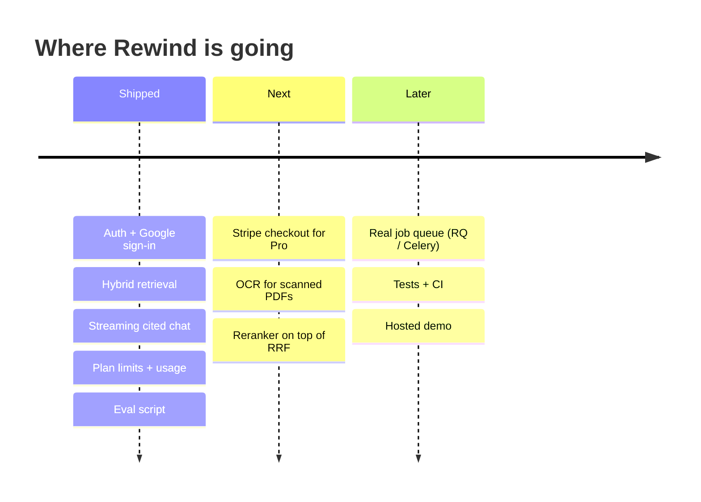

---

<div align="center">

**Built so every answer can be checked.** ⏪

If Rewind helped you, a ⭐ on the repo means a lot.

</div>
